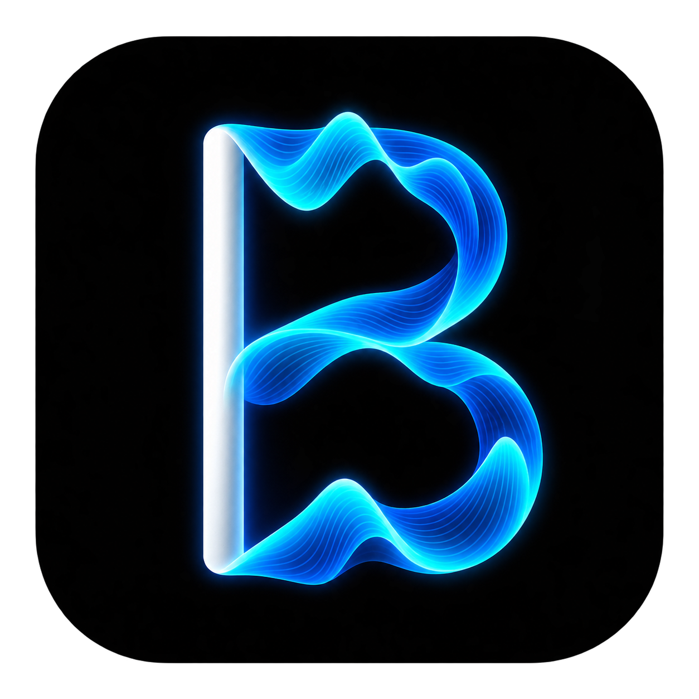

# BRAGA VOICE

Aplicativo local para preparar roteiros e gerar voz com IA usando a conta
ElevenLabs de cada usuário. A interface, o histórico e os áudios ficam no Mac;
a chave nunca é incluída no aplicativo, no Git ou nas respostas da API local.



## O que já funciona

- aplicativo nativo para macOS com Swift, WebKit e backend FastAPI embutido;
- conexão individual com ElevenLabs pela própria tela do aplicativo;
- listagem das vozes pertencentes à conta conectada;
- Diretor de Narração local: prepara espaços, pontuação, listas,
  abreviações, pausas e frases longas para fala natural em português brasileiro;
- estilos Natural, Comercial e Institucional em Eleven v4, além de Urgente e
  Teste rápido para menor latência;
- síntese, player, download e armazenamento local;
- skill portátil para Codex e Claude Code;
- testes automatizados e verificação de privacidade antes de publicar.

## Privacidade por padrão

Cada instalação é isolada. A chave, os IDs de voz, os roteiros, os áudios e o
histórico pertencem ao usuário daquele computador e não acompanham o código.

| Dado | Local padrão | Vai para o Git? |
|---|---|---|
| Chave ElevenLabs | `~/Library/Application Support/BRAGA VOICE/.env` | Não |
| Áudios | `~/Library/Application Support/BRAGA VOICE/audio/` | Não |
| Histórico | `~/Library/Application Support/BRAGA VOICE/history/` | Não |
| Logs locais | `~/Library/Logs/BRAGA VOICE/` | Não |

O backend escuta somente em `127.0.0.1`. O BRAGA VOICE envia à ElevenLabs
apenas o texto solicitado, o ID da voz selecionada e os parâmetros necessários
à geração. Consulte [PRIVACY.md](PRIVACY.md) e [SECURITY.md](SECURITY.md).

## Instalação rápida no macOS

Para instalar o aplicativo pronto, abra a página de
[Releases](https://github.com/GeneralBraga/braga-voice/releases/latest) e baixe
o arquivo correto para o processador do Mac:

- **Mac M1, M2, M3, M4 ou posterior:** `macOS-arm64.zip`;
- **Mac Intel Core i5, i7, i9 ou Xeon:** `macOS-x86_64.zip`.

Descompacte e mova **BRAGA VOICE.app** para **Aplicativos**.

Requisito atual: macOS 14 ou superior em Mac Apple Silicon ou Intel. Não é
necessário instalar Python, Xcode ou usar o Terminal.
Como esta versão ainda não possui Developer ID/notarização Apple, na primeira
abertura use **clique com botão direito → Abrir → Abrir**.

O passo a passo completo está em
[Instalar no Mac](docs/INSTALAR-NO-MAC.md).

## Instalação pelo código-fonte

Para desenvolver ou construir o aplicativo, são necessários Python 3.11+ e
Xcode Command Line Tools:

```bash
git clone https://github.com/GeneralBraga/braga-voice.git
cd braga-voice
./scripts/install.sh
```

Depois, abra **BRAGA VOICE** pela pasta Aplicativos. Clique em **Configurar**,
cole a sua própria chave ElevenLabs e escolha uma voz da sua conta.

Você pode colar o roteiro como ele estiver. Antes de gerar, use **Preparar
narração**: o aplicativo mostra o texto exato que será enviado para a síntese
e lista os ajustes aplicados. Essa preparação é local e não consome créditos.

Para desenvolvimento:

```bash
./scripts/start.sh
```

Para validar:

```bash
./scripts/check.sh
```

## Skill para Codex e Claude Code

Instale a skill nos dois ambientes:

```bash
./scripts/install-agent-skill.sh
```

Ela é copiada para:

- `~/.codex/skills/braga-voice/`
- `~/.claude/skills/braga-voice/`

Depois, peça: `Use $braga-voice para preparar este roteiro e gerar a voz`.
A skill usa somente a API local; ela não recebe a chave ElevenLabs.

## Documentação

- [Instalar no Mac](docs/INSTALAR-NO-MAC.md)
- [Conectar a ElevenLabs](docs/SETUP-ELEVENLABS.md)
- [Aplicativo macOS](docs/MACOS-APP.md)
- [Arquitetura](docs/ARQUITETURA.md)
- [API local](docs/API.md)
- [Qualidade e naturalidade](docs/QUALIDADE-DE-VOZ.md)
- [Privacidade](PRIVACY.md)
- [Segurança](SECURITY.md)

## Uso responsável

Use somente vozes próprias ou com autorização verificável. Não use o produto
para fraude, falsificação de identidade, assédio ou conteúdo enganoso. Ao
publicar áudio sintético, identifique sua natureza quando o contexto puder
induzir alguém a acreditar que se trata de uma gravação humana real.

## Estado da distribuição

A versão pública atual possui pacotes nativos separados para macOS Apple
Silicon (`arm64`) e Intel (`x86_64`). O bundle usa assinatura local ad hoc.
Distribuição sem avisos do Gatekeeper exige Developer ID e notarização Apple,
que ainda não fazem parte deste repositório.
